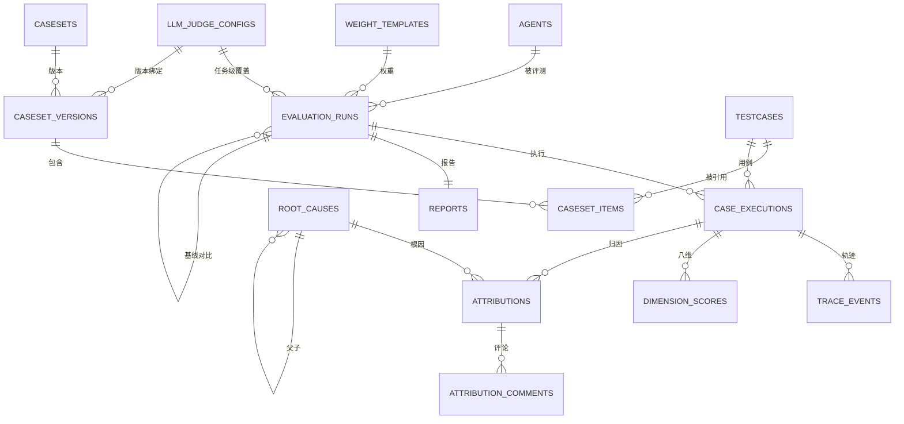

# CapEval 数据库表结构

> 适用版本：`4b9fc25` 及之后。数据库为 MySQL 8.0（`utf8mb4`），共 19 张表（含迁移表 `alembic_version`）。
> 本文由本地运行实例实时导出，与 `backend/alembic/versions/` 中的迁移脚本保持一致；升级代码后执行 `alembic upgrade head` 即可。

## 一、表清单

### 系统与配置

| 表名 | 说明 |
| --- | --- |
| [`users`](#users) | 平台用户与角色。MVP 阶段不做登录态校验，通过 `X-Acting-User` 头切换身份；写操作要求 admin / evaluator。 |
| [`agents`](#agents) | 被评测的 Code Agent 配置。凭证加密存储、展示用脱敏值；`resource_limits` 决定 host / docker 隔离与资源上限，镜像不在 Agent 上配置，由用例提供。 |
| [`weight_templates`](#weight_templates) | 八维权重模板。支持任意维度子集，选中维度权重总和必须为 1.0；默认模板不可删除。 |
| [`llm_judge_configs`](#llm_judge_configs) | LLM-as-Judge 评审模型配置（OpenAI 兼容），按维度配置 rubric；未启用或异常时回退规则评分。 |
| [`root_causes`](#root_causes) | 根因库，三级自引用结构；内置种子仅在库为空时幂等回填。 |
| [`rootcause_library_versions`](#rootcause_library_versions) | 根因库版本记录，每次在线维护自动递增。 |

### 评测资产

| 表名 | 说明 |
| --- | --- |
| [`testcases`](#testcases) | 评测用例，是评测的最小单元。包含多轮任务脚本、仓库快照、执行环境、验收定义、成本基线、标准答案。 |
| [`casesets`](#casesets) | 评测集（逻辑容器），通过版本管理内容；改名不影响已发布版本。 |
| [`caseset_versions`](#caseset_versions) | 评测集版本。草稿可编辑，发布后冻结；版本可绑定评审模型，绑定关系随发布固化。 |
| [`caseset_items`](#caseset_items) | 版本与用例的关联表，记录用例在版本内的执行顺序。 |

### 评测执行

| 表名 | 说明 |
| --- | --- |
| [`evaluation_runs`](#evaluation_runs) | 评测任务。创建时固化权重模板与根因库版本快照，状态机严格流转；支持基线 Run 与 Pass@k。 |
| [`case_executions`](#case_executions) | 每个用例在任务中的一次执行记录（Pass@k 会生成多条，用 repetition_no 区分）。 |
| [`trace_events`](#trace_events) | 轨迹事件，按 message / tool_call / file_change / terminal / resource / system 六类落库，是报告、归因与回放的统一数据源。 |

### 评分、报告与归因

| 表名 | 说明 |
| --- | --- |
| [`dimension_scores`](#dimension_scores) | 用例执行的八维得分，`details` 保存可解释信号链。 |
| [`reports`](#reports) | 任务报告，按 run_id 一对一 upsert 写入；包含质量分、效率分、报告正文与分享令牌。 |
| [`attributions`](#attributions) | 失败归因结果，关联根因与证据链，支持人工复核留痕。 |
| [`attribution_comments`](#attribution_comments) | 归因的讨论评论。 |

### 运营支撑

| 表名 | 说明 |
| --- | --- |
| [`notifications`](#notifications) | 站内通知，按 dedupe_key 去重，支持查询、单条已读、全部已读。 |
| [`alembic_version`](#alembic_version) | Alembic 迁移版本表，由迁移工具自动维护，业务代码不读写。 |

## 二、实体关系图



说明：`evaluation_runs.baseline_run_id` 指向同表的历史 Run；`root_causes.parent_id` 构成三级自引用；`reports.run_id` 唯一，保证一任务一报告。

## 三、表结构明细

### users

平台用户与角色。MVP 阶段不做登录态校验，通过 `X-Acting-User` 头切换身份；写操作要求 admin / evaluator。

| 字段 | 类型 | 可空 | 键 | 默认值 | 说明 |
| --- | --- | --- | --- | --- | --- |
| `id` | bigint | 否 | PK |  | 主键 |
| `username` | varchar(64) | 否 | UK |  | 登录名，唯一 |
| `display_name` | varchar(128) | 否 |  |  | 显示名 |
| `role` | varchar(32) | 否 |  |  | 角色：admin / evaluator / viewer |
| `created_at` | datetime | 否 |  | CURRENT_TIMESTAMP | 创建时间 |

**索引**

- `username`（唯一）：`username`

### agents

被评测的 Code Agent 配置。凭证加密存储、展示用脱敏值；`resource_limits` 决定 host / docker 隔离与资源上限，镜像不在 Agent 上配置，由用例提供。

| 字段 | 类型 | 可空 | 键 | 默认值 | 说明 |
| --- | --- | --- | --- | --- | --- |
| `id` | bigint | 否 | PK |  | 主键 |
| `name` | varchar(128) | 否 | IDX |  | 名称 |
| `version_label` | varchar(64) | 否 |  |  | Agent 版本标识（如 CLI 版本） |
| `access_type` | varchar(16) | 否 |  |  | 接入类型：http / cli |
| `adapter_key` | varchar(64) | 否 |  |  | 适配器键：echo_cli / generic_cli / qoder_cli / http_api |
| `adapter_config` | json | 否 |  |  | 适配器参数 JSON：base_url、headers、command、args、cwd 等 |
| `credential_masked` | varchar(128) | 否 |  |  | 脱敏后的凭证（仅用于展示） |
| `credential_encrypted` | text | 否 |  |  | 加密后的凭证原文，执行时解密使用 |
| `resource_limits` | json | 否 |  |  | 资源与隔离配置 JSON：isolation_mode、max_memory_mb、max_cpu_seconds、max_turns、timeout_seconds、max_cost、network 等 |
| `cost_params` | json | 否 |  |  | 成本计量参数 JSON：input_token_price、output_token_price 等 |
| `status` | varchar(32) | 否 |  |  | 状态 |
| `last_verify_at` | datetime | 是 |  |  | 最近一次连通性校验时间 |
| `last_verify_error` | text | 否 |  |  | 最近一次校验错误信息 |
| `created_at` | datetime | 否 |  | CURRENT_TIMESTAMP | 创建时间 |
| `updated_at` | datetime | 否 |  | CURRENT_TIMESTAMP | 更新时间 |

**索引**

- `uq_agent_name_version`（唯一）：`name,version_label`

**JSON 字段示例**

```json
{
  "adapter_config": {"command": "qoderclicn", "args": ["--permission-mode", "bypass_permissions"], "cwd": "."},
  "resource_limits": {
    "isolation_mode": "docker",
    "max_memory_mb": 2048,
    "max_cpu_seconds": 300,
    "max_turns": 20,
    "timeout_seconds": 600,
    "max_cost": 2.0,
    "network": "allow"
  },
  "cost_params": {"input_token_price": 0.000002, "output_token_price": 0.000008}
}
```

### weight_templates

八维权重模板。支持任意维度子集，选中维度权重总和必须为 1.0；默认模板不可删除。

| 字段 | 类型 | 可空 | 键 | 默认值 | 说明 |
| --- | --- | --- | --- | --- | --- |
| `id` | bigint | 否 | PK |  | 主键 |
| `name` | varchar(128) | 否 | UK |  | 名称 |
| `is_default` | tinyint(1) | 否 |  |  | 是否默认模板（不可删除、不可取消默认） |
| `weights` | json | 否 |  |  | 各维度权重 JSON，如 {D1:0.3,...}，总和为 1 |
| `status` | varchar(16) | 否 |  |  | 状态：active / archived |
| `created_at` | datetime | 否 |  | CURRENT_TIMESTAMP | 创建时间 |

**索引**

- `name`（唯一）：`name`

### llm_judge_configs

LLM-as-Judge 评审模型配置（OpenAI 兼容），按维度配置 rubric；未启用或异常时回退规则评分。

| 字段 | 类型 | 可空 | 键 | 默认值 | 说明 |
| --- | --- | --- | --- | --- | --- |
| `id` | bigint | 否 | PK |  | 主键 |
| `enabled` | tinyint(1) | 否 |  | 0 | 是否启用 |
| `provider` | varchar(32) | 否 |  | openai_compatible | 提供方标识（OpenAI 兼容） |
| `base_url` | varchar(256) | 否 |  |  | OpenAI 兼容接口地址 |
| `model` | varchar(128) | 否 |  |  | 模型名 |
| `api_key` | varchar(512) | 否 |  |  | API Key |
| `temperature` | float | 否 |  | 0.2 | 采样温度 |
| `max_tokens` | int | 否 |  | 800 | 最大输出 token |
| `timeout_seconds` | int | 否 |  | 60 | 请求超时（秒） |
| `dimensions` | json | 否 |  |  | 参与模型评分的维度数组 |
| `updated_by` | varchar(64) | 否 |  | system | 最后修改人 |
| `updated_at` | datetime | 是 |  | CURRENT_TIMESTAMP | 更新时间 |
| `name` | varchar(64) | 否 | UK |  | 名称 |
| `is_default` | tinyint(1) | 否 |  | 0 | 是否全局默认配置 |
| `rubrics` | json | 是 |  |  | 各维度 rubric 评分标准 JSON |
| `created_at` | datetime | 是 |  | CURRENT_TIMESTAMP | 创建时间 |

**索引**

- `uq_llm_judge_config_name`（唯一）：`name`

**JSON 字段示例**

```json
{
  "dimensions": ["D4", "D7", "D8"],
  "rubrics": {
    "D7": "5 分：命名与格式完全符合约定；3 分：少量不一致；1 分：风格混乱",
    "D8": "按工程化程度分档，关注构建、依赖、测试组织"
  }
}
```

### root_causes

根因库，三级自引用结构；内置种子仅在库为空时幂等回填。

| 字段 | 类型 | 可空 | 键 | 默认值 | 说明 |
| --- | --- | --- | --- | --- | --- |
| `id` | bigint | 否 | PK |  | 主键 |
| `code` | varchar(32) | 否 | UK |  | 根因编码（如 RC-10），唯一 |
| `level` | int | 否 |  |  | 层级：1 大类 / 2 子类 / 3 具体原因 |
| `parent_id` | bigint | 是 | IDX |  | 上级根因（三级自引用） |
| `name` | varchar(128) | 否 |  |  | 名称 |
| `description` | text | 否 |  |  | 描述 |
| `responsibility` | varchar(32) | 否 |  |  | 责任归属：agent / case / platform |
| `detection_signals` | json | 否 |  |  | 检测信号 JSON，用于规则归因匹配 |
| `enabled` | tinyint(1) | 否 |  |  | 是否启用 |
| `introduced_version` | int | 否 |  |  | 引入的根因库版本 |
| `created_at` | datetime | 否 |  | CURRENT_TIMESTAMP | 创建时间 |
| `updated_at` | datetime | 否 |  | CURRENT_TIMESTAMP | 更新时间 |

**索引**

- `code`（唯一）：`code`
- `ix_root_causes_parent_id`（普通）：`parent_id`

**外键**

- `parent_id` → `root_causes.id`

**JSON 字段示例**

```json
{
  "detection_signals": {"event_types": ["terminal"], "exit_code": 127, "keywords": ["command not found"]}
}
```

### rootcause_library_versions

根因库版本记录，每次在线维护自动递增。

| 字段 | 类型 | 可空 | 键 | 默认值 | 说明 |
| --- | --- | --- | --- | --- | --- |
| `id` | bigint | 否 | PK |  | 主键 |
| `version_no` | int | 否 | UK |  | 根因库版本号 |
| `note` | text | 否 |  |  | 版本变更说明 |
| `created_at` | datetime | 否 |  | CURRENT_TIMESTAMP | 创建时间 |

**索引**

- `version_no`（唯一）：`version_no`

### testcases

评测用例，是评测的最小单元。包含多轮任务脚本、仓库快照、执行环境、验收定义、成本基线、标准答案。

| 字段 | 类型 | 可空 | 键 | 默认值 | 说明 |
| --- | --- | --- | --- | --- | --- |
| `id` | bigint | 否 | PK |  | 主键 |
| `title` | varchar(256) | 否 |  |  | 用例标题 |
| `task_script` | json | 否 |  |  | 多轮任务脚本 JSON：turns[].prompt / expected_keywords 等 |
| `repo_snapshot` | json | 否 |  |  | 仓库快照 JSON：{type:'files', files:{相对路径: 内容}} |
| `env_def` | json | 否 |  |  | 执行环境 JSON：target_isolation、docker_image、docker_volumes、install_commands |
| `acceptance` | json | 否 |  |  | 验收定义 JSON：auto_commands、exit_code、semantic_points、flow_expectations |
| `efficiency_baseline` | json | 否 |  |  | 成本基线 JSON：token_baseline |
| `difficulty` | varchar(16) | 否 |  |  | 难度：easy / medium / hard |
| `tags` | json | 否 |  |  | 标签数组 JSON |
| `est_minutes` | int | 否 |  |  | 预计耗时（分钟） |
| `status` | varchar(16) | 否 |  |  | 状态：active / archived |
| `created_at` | datetime | 否 |  | CURRENT_TIMESTAMP | 创建时间 |
| `updated_at` | datetime | 否 |  | CURRENT_TIMESTAMP | 更新时间 |
| `gold_patch` | text | 是 |  |  | 标准答案补丁（Gold Patch） |

**索引**


**JSON 字段示例**

```json
{
  "task_script": {"turns": [{"prompt": "修复订单折扣计算...", "expected_keywords": ["Decimal"]}]},
  "repo_snapshot": {"type": "files", "files": {"app/pricing.py": "...", "tests/test_pricing.py": "..."}},
  "env_def": {
    "target_isolation": "docker",
    "docker_image": "python:3.12-slim",
    "docker_volumes": ["/Users/me/.capeval-cache/m2:/root/.m2"],
    "install_commands": ["pip install -r requirements.txt -q"]
  },
  "acceptance": {
    "auto_commands": ["python3 -m unittest test_pricing -v"],
    "exit_code": 0,
    "semantic_points": ["金额计算不得使用 float 近似"],
    "flow_expectations": ["先阅读代码再修改"]
  },
  "efficiency_baseline": {"token_baseline": 20000}
}
```

### casesets

评测集（逻辑容器），通过版本管理内容；改名不影响已发布版本。

| 字段 | 类型 | 可空 | 键 | 默认值 | 说明 |
| --- | --- | --- | --- | --- | --- |
| `id` | bigint | 否 | PK |  | 主键 |
| `name` | varchar(128) | 否 | UK |  | 名称 |
| `description` | text | 否 |  |  | 描述 |
| `is_builtin` | tinyint(1) | 否 |  |  | 是否内置用例集 |
| `created_at` | datetime | 否 |  | CURRENT_TIMESTAMP | 创建时间 |

**索引**

- `name`（唯一）：`name`

### caseset_versions

评测集版本。草稿可编辑，发布后冻结；版本可绑定评审模型，绑定关系随发布固化。

| 字段 | 类型 | 可空 | 键 | 默认值 | 说明 |
| --- | --- | --- | --- | --- | --- |
| `id` | bigint | 否 | PK |  | 主键 |
| `caseset_id` | bigint | 否 | IDX |  |  |
| `version_no` | int | 否 |  |  | 版本号，从 1 递增 |
| `status` | varchar(16) | 否 |  |  | 状态：draft（可编辑）/ published（冻结） |
| `published_at` | datetime | 是 |  |  | 发布时间 |
| `created_at` | datetime | 否 |  | CURRENT_TIMESTAMP | 创建时间 |
| `judge_config_id` | bigint | 是 | IDX |  | 版本绑定的评审模型（发布后随版本冻结） |

**索引**

- `fk_caseset_version_judge_config`（普通）：`judge_config_id`
- `ix_caseset_versions_caseset_id`（普通）：`caseset_id`
- `uq_caseset_version`（唯一）：`caseset_id,version_no`

**外键**

- `caseset_id` → `casesets.id`
- `judge_config_id` → `llm_judge_configs.id`

### caseset_items

版本与用例的关联表，记录用例在版本内的执行顺序。

| 字段 | 类型 | 可空 | 键 | 默认值 | 说明 |
| --- | --- | --- | --- | --- | --- |
| `id` | bigint | 否 | PK |  | 主键 |
| `version_id` | bigint | 否 | IDX |  | 所属用例集版本 |
| `testcase_id` | bigint | 否 | IDX |  | 引用的评测用例 |
| `order_no` | int | 否 |  |  | 执行顺序 |

**索引**

- `ix_caseset_items_version_id`（普通）：`version_id`
- `testcase_id`（普通）：`testcase_id`

**外键**

- `testcase_id` → `testcases.id`
- `version_id` → `caseset_versions.id`

### evaluation_runs

评测任务。创建时固化权重模板与根因库版本快照，状态机严格流转；支持基线 Run 与 Pass@k。

| 字段 | 类型 | 可空 | 键 | 默认值 | 说明 |
| --- | --- | --- | --- | --- | --- |
| `id` | bigint | 否 | PK |  | 主键 |
| `name` | varchar(256) | 否 |  |  | 任务名称 |
| `agent_id` | bigint | 否 | IDX |  | 被评测 Agent |
| `caseset_version_id` | bigint | 否 | IDX |  | 评测集版本（提交后固化） |
| `weight_template_id` | bigint | 否 | IDX |  | 权重模板 |
| `weight_snapshot` | json | 否 |  |  | 创建时固化的权重快照 JSON |
| `rootcause_version` | int | 否 |  |  | 创建时固化的根因库版本号 |
| `review_policy` | varchar(32) | 否 |  |  | 抽检策略：skip（不抽检）/ sample（低置信度必抽 + 其余 50% 随机）/ full（全量） |
| `fail_threshold` | float | 否 |  |  | 任务失败率阈值（0–1），默认 0.5 |
| `baseline_run_id` | bigint | 是 |  |  | 基线 Run，用于报告中的分数对比 |
| `status` | varchar(24) | 否 | IDX |  | 状态机：draft→queued→running→attributing→reviewing→completed / failed / canceled |
| `error` | text | 否 |  |  | 任务级错误信息 |
| `created_by` | varchar(64) | 否 |  |  | 创建人 |
| `created_at` | datetime | 否 |  | CURRENT_TIMESTAMP | 创建时间 |
| `submitted_at` | datetime | 是 |  |  | 提交执行时间 |
| `completed_at` | datetime | 是 |  |  | 完成时间 |
| `judge_config_id` | bigint | 是 | IDX |  | 任务级评审模型覆盖 |
| `pass_k` | int | 否 |  | 1 | Pass@k 重复执行次数，默认 1 |

**索引**

- `caseset_version_id`（普通）：`caseset_version_id`
- `fk_evaluation_run_judge_config`（普通）：`judge_config_id`
- `ix_evaluation_runs_agent_id`（普通）：`agent_id`
- `ix_evaluation_runs_status`（普通）：`status`
- `weight_template_id`（普通）：`weight_template_id`

**外键**

- `agent_id` → `agents.id`
- `caseset_version_id` → `caseset_versions.id`
- `weight_template_id` → `weight_templates.id`
- `judge_config_id` → `llm_judge_configs.id`

**JSON 字段示例**

```json
{
  "weight_snapshot": {"D1": 0.3, "D2": 0.2, "D3": 0.15, "D4": 0.1, "D5": 0.1, "D7": 0.075, "D8": 0.075}
}
```

### case_executions

每个用例在任务中的一次执行记录（Pass@k 会生成多条，用 repetition_no 区分）。

| 字段 | 类型 | 可空 | 键 | 默认值 | 说明 |
| --- | --- | --- | --- | --- | --- |
| `id` | bigint | 否 | PK |  | 主键 |
| `run_id` | bigint | 否 | IDX |  | 所属评测任务 |
| `testcase_id` | bigint | 否 | IDX |  | 评测用例 |
| `order_no` | int | 否 |  |  | 任务内执行序号 |
| `status` | varchar(16) | 否 |  |  | 状态：pending / running / succeeded / failed / canceled |
| `rerun_count` | int | 否 |  |  | 重试次数 |
| `resource_usage` | json | 否 |  |  | 资源用量 JSON：tokens、cost、duration_ms 等 |
| `error` | text | 否 |  |  | 失败原因 |
| `started_at` | datetime | 是 |  |  | 开始时间 |
| `finished_at` | datetime | 是 |  |  | 结束时间 |
| `repetition_no` | int | 否 |  | 0 | Pass@k 第几次重复（从 0 开始） |

**索引**

- `ix_case_executions_run_id`（普通）：`run_id`
- `testcase_id`（普通）：`testcase_id`

**外键**

- `run_id` → `evaluation_runs.id`
- `testcase_id` → `testcases.id`

### trace_events

轨迹事件，按 message / tool_call / file_change / terminal / resource / system 六类落库，是报告、归因与回放的统一数据源。

| 字段 | 类型 | 可空 | 键 | 默认值 | 说明 |
| --- | --- | --- | --- | --- | --- |
| `id` | bigint | 否 | PK |  | 主键 |
| `execution_id` | bigint | 否 | IDX |  | 所属用例执行 |
| `seq` | int | 否 |  |  | 事件序号，单调递增 |
| `event_type` | varchar(32) | 否 |  |  | 消息 / 工具调用 / 文件变更 / 终端 / 资源 / 系统 |
| `payload` | json | 否 |  |  | 事件载荷 JSON：prompt、response、command、exit_code、isolation、image、kind 等 |
| `truncated` | tinyint(1) | 否 |  |  | 是否因超长被截断 |
| `created_at` | datetime | 否 |  | CURRENT_TIMESTAMP | 创建时间 |

**索引**

- `ix_trace_events_execution_id`（普通）：`execution_id`

**外键**

- `execution_id` → `case_executions.id`

**JSON 字段示例**

```json
{
  "event_type": "terminal",
  "payload": {
    "command": "python3 -m unittest test_pricing -v",
    "exit_code": 1,
    "isolation": "docker",
    "image": "python:3.12-slim",
    "stdout_tail": "FAILED (failures=2)"
  }
}
```

### dimension_scores

用例执行的八维得分，`details` 保存可解释信号链。

| 字段 | 类型 | 可空 | 键 | 默认值 | 说明 |
| --- | --- | --- | --- | --- | --- |
| `id` | bigint | 否 | PK |  | 主键 |
| `execution_id` | bigint | 否 | IDX |  | 所属用例执行 |
| `dimension` | varchar(8) | 否 |  |  | 维度：D1–D8 |
| `score` | float | 否 |  |  | 该维度得分（0–5） |
| `details` | json | 否 |  |  | 评分明细 JSON：signals、method、rubric 结果 |
| `created_at` | datetime | 否 |  | CURRENT_TIMESTAMP | 创建时间 |

**索引**

- `ix_dimension_scores_execution_id`（普通）：`execution_id`

**外键**

- `execution_id` → `case_executions.id`

### reports

任务报告，按 run_id 一对一 upsert 写入；包含质量分、效率分、报告正文与分享令牌。

| 字段 | 类型 | 可空 | 键 | 默认值 | 说明 |
| --- | --- | --- | --- | --- | --- |
| `id` | bigint | 否 | PK |  | 主键 |
| `run_id` | bigint | 否 | UK |  | 所属评测任务，一对一 |
| `quality_score` | float | 是 |  |  | 质量分（百分制） |
| `efficiency_score` | float | 是 |  |  | 效率分（百分制） |
| `dimension_summary` | json | 否 |  |  | 八维汇总 JSON |
| `content` | json | 否 |  |  | 报告正文 JSON：概览、用例明细、归因、对比等 |
| `export_path` | varchar(512) | 否 |  |  | 导出的 HTML/PDF 路径 |
| `share_token` | varchar(64) | 否 |  |  | 免登录分享令牌 |
| `review_mark` | varchar(24) | 否 |  |  | 复核标记 |
| `created_at` | datetime | 否 |  | CURRENT_TIMESTAMP | 创建时间 |
| `share_expires_at` | datetime | 是 |  |  | 分享链接过期时间（默认 7 天） |

**索引**

- `run_id`（唯一）：`run_id`

**外键**

- `run_id` → `evaluation_runs.id`

**JSON 字段示例**

```json
{
  "dimension_summary": {"D1": 3.2, "D2": 4.0, "D3": 3.5, "D4": 4.2, "D5": 5.0, "D6": 4.1, "D7": 3.8, "D8": 3.6},
  "content": {
    "overview": {"quality_score": 74.2, "efficiency_score": 81.0, "baseline_delta": {"quality": 2.5, "efficiency": -1.2}},
    "cases": [],
    "attributions": [],
    "data_integrity": {"D3": "missing", "D6": "estimated"}
  }
}
```

### attributions

失败归因结果，关联根因与证据链，支持人工复核留痕。

| 字段 | 类型 | 可空 | 键 | 默认值 | 说明 |
| --- | --- | --- | --- | --- | --- |
| `id` | bigint | 否 | PK |  | 主键 |
| `execution_id` | bigint | 否 | IDX |  | 关联用例执行 |
| `rootcause_id` | bigint | 否 | IDX |  | 命中根因 |
| `is_primary` | tinyint(1) | 否 |  |  | 是否主根因 |
| `confidence` | float | 否 |  |  | 置信度（0–1） |
| `source` | varchar(16) | 否 |  |  | 来源：rule / llm / manual |
| `evidence` | json | 否 |  |  | 证据链 JSON：引用的轨迹事件 ID 与片段 |
| `review_status` | varchar(24) | 否 |  |  | 复核状态：pending / not_sampled / confirmed / corrected / rejected |
| `reviewed_by` | varchar(64) | 否 |  |  | 复核人 |
| `review_note` | text | 否 |  |  | 复核备注 |
| `created_at` | datetime | 否 |  | CURRENT_TIMESTAMP | 创建时间 |
| `review_history` | json | 是 |  |  | 复核操作留痕 JSON |

**索引**

- `ix_attributions_execution_id`（普通）：`execution_id`
- `rootcause_id`（普通）：`rootcause_id`

**外键**

- `execution_id` → `case_executions.id`
- `rootcause_id` → `root_causes.id`

**JSON 字段示例**

```json
{
  "evidence": [{"event_id": 1746, "seq": 12, "snippet": "sh: 1: node: not found"}],
  "review_history": [{"at": "2026-10-22T10:00:00Z", "by": "alice", "from": "pending", "to": "confirmed", "note": "确认镜像缺失"}]
}
```

### attribution_comments

归因的讨论评论。

| 字段 | 类型 | 可空 | 键 | 默认值 | 说明 |
| --- | --- | --- | --- | --- | --- |
| `id` | bigint | 否 | PK |  | 主键 |
| `attribution_id` | bigint | 否 | IDX |  | 所属归因 |
| `author` | varchar(64) | 否 |  |  | 评论人 |
| `role` | varchar(32) | 否 |  | viewer | 评论人角色 |
| `content` | text | 否 |  |  | 评论内容 |
| `created_at` | datetime | 是 |  | CURRENT_TIMESTAMP | 创建时间 |

**索引**

- `ix_attribution_comments_attribution_id`（普通）：`attribution_id`

**外键**

- `attribution_id` → `attributions.id`

### notifications

站内通知，按 dedupe_key 去重，支持查询、单条已读、全部已读。

| 字段 | 类型 | 可空 | 键 | 默认值 | 说明 |
| --- | --- | --- | --- | --- | --- |
| `id` | bigint | 否 | PK |  | 主键 |
| `recipient` | varchar(64) | 否 | IDX |  | 接收人用户名 |
| `category` | varchar(32) | 否 | IDX |  | 类别：run_status / selfcheck_failed / agent_error / group_failure |
| `title` | varchar(256) | 否 |  |  | 标题 |
| `content` | text | 否 |  |  | 正文 |
| `link` | varchar(256) | 否 |  |  | 前端跳转链接 |
| `dedupe_key` | varchar(191) | 否 | IDX |  | 去重键，唯一约束避免重复通知 |
| `read_at` | datetime | 是 |  |  | 已读时间，空表示未读 |
| `created_at` | datetime | 是 |  | CURRENT_TIMESTAMP | 创建时间 |

**索引**

- `ix_notifications_category`（普通）：`category`
- `ix_notifications_dedupe_key`（普通）：`dedupe_key`
- `ix_notifications_recipient`（普通）：`recipient`

### alembic_version

Alembic 迁移版本表，由迁移工具自动维护，业务代码不读写。

| 字段 | 类型 | 可空 | 键 | 默认值 | 说明 |
| --- | --- | --- | --- | --- | --- |
| `version_num` | varchar(32) | 否 | PK |  | 当前迁移版本号 |

**索引**


## 四、关键枚举与取值

| 字段 | 取值 |
| --- | --- |
| `agents.access_type` | `http` / `cli` |
| `agents.adapter_key` | `echo_cli` / `generic_cli` / `qoder_cli` / `http_api` |
| `agents.resource_limits.isolation_mode` | `host` / `docker` |
| `testcases.env_def.target_isolation` | `docker` / `host` / `any` |
| `testcases.difficulty` | `easy` / `medium` / `hard` |
| `caseset_versions.status` | `draft` / `published` |
| `evaluation_runs.status` | `draft` / `queued` / `running` / `attributing` / `reviewing` / `completed` / `failed` / `canceled` |
| `case_executions.status` | `pending` / `running` / `succeeded` / `failed` / `canceled` |
| `trace_events.event_type` | `message` / `tool_call` / `file_change` / `terminal` / `resource` / `system` |
| `dimension_scores.dimension` | `D1`–`D8` |
| `attributions.source` | `rule` / `llm` / `manual` |
| `attributions.review_status` | `pending` / `not_sampled` / `confirmed` / `corrected` / `rejected` |
| `evaluation_runs.review_policy` | `skip` / `sample` / `full` |
| `agents.status` | `available` / `unverified` / `verify_failed` / `unavailable` |
| `root_causes.responsibility` | `agent` / `case_maintainer` / `platform` |
| `notifications.category` | `run_status` / `review_overdue` / `agent_alert` |
| `users.role` | `admin` / `evaluator` / `viewer` |

八维定义：D1 代码正确性、D2 研发流程遵从、D3 工具调用准确性、D4 多轮会话一致性、D5 安全性、D6 成本与效率、D7 代码风格、D8 工程化。

## 五、常用查询

```sql
-- 某个任务的用例执行概览
SELECT ce.order_no, ce.repetition_no, t.title, ce.status, ce.finished_at
FROM case_executions ce JOIN testcases t ON t.id = ce.testcase_id
WHERE ce.run_id = ? ORDER BY ce.order_no, ce.repetition_no;

-- 某次执行的八维得分
SELECT dimension, score FROM dimension_scores WHERE execution_id = ? ORDER BY dimension;

-- 某次执行命中的根因（按置信度）
SELECT rc.code, rc.name, a.confidence, a.is_primary, a.review_status
FROM attributions a JOIN root_causes rc ON rc.id = a.rootcause_id
WHERE a.execution_id = ? ORDER BY a.is_primary DESC, a.confidence DESC;

-- docker 隔离下的验收命令记录
SELECT id, seq, JSON_UNQUOTE(JSON_EXTRACT(payload, '$.command')) AS cmd,
       JSON_EXTRACT(payload, '$.exit_code') AS rc
FROM trace_events
WHERE execution_id = ? AND event_type = 'terminal'
  AND JSON_UNQUOTE(JSON_EXTRACT(payload, '$.isolation')) = 'docker'
ORDER BY seq;
```

## 六、迁移与维护

- 表结构以 Alembic 迁移为准：新增字段必须写迁移脚本，禁止手工改线上表。
- 升级：`cd backend && alembic upgrade head`；生产环境建议先执行 `alembic current` 与备份。
- 轨迹清理默认保留 180 天，被证据链引用的片段豁免；报告永久保留。
- 数据清理顺序（子→父）：`attribution_comments → attributions → reports → dimension_scores → trace_events → notifications → case_executions → evaluation_runs → caseset_items → caseset_versions → casesets → testcases → agents`；根因库、权重模板、用户、评审模型属于系统配置，不清理。

---

如需扩展表结构，请同步更新本文档；文档与迁移不一致时，以 `alembic upgrade head` 后的实际表结构为准。
